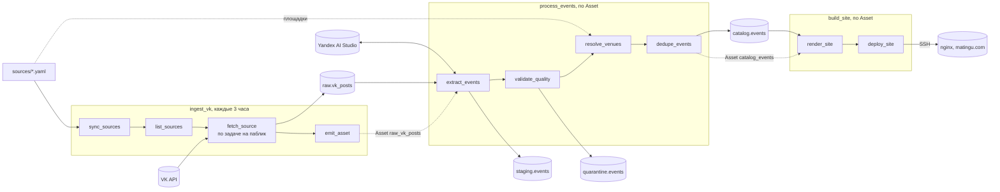

# FunFinder

Агрегатор городских событий. Собирает анонсы из пабликов VK, Telegram-каналов и сайтов площадок, превращает свободный текст в структурированный каталог и показывает его на сайте и в каналах. Пилотный город — Липецк.

Пайплайн на **Apache Airflow 3** и **PostgreSQL**, извлечение событий из текста — **LLM** (Yandex AI Studio).

**Статус: этап 1 в работе.** Этап 0 готов: посты VK загружаются в `raw`, LLM извлекает из них события, проверки качества отправляют плохое в карантин, дубли склеиваются в каталог. Из каталога собирается сайт-афиша [matingu.com](https://matingu.com) и выкладывается на сервер. Дальше — канал с ежедневными подборками (`publish`).

## Как устроено



**`ingest_vk`** — каждые 3 часа забирает посты из пабликов.

| Задача | Что делает |
|---|---|
| `sync_sources` | Переносит список пабликов из `sources/<город>.yaml` в `meta.sources`, справочник площадок из `sources/venues/<город>.yaml` — в `meta.venues`. Убранный из файла паблик становится неактивным, его посты остаются. |
| `list_sources` | Активные VK-источники из базы. |
| `fetch_source` | Dynamic task mapping: отдельная задача на каждый паблик, не больше двух одновременно. Инкремент по id поста плюс перепроверка последней недели на правки. |
| `emit_asset` | Публикует Asset `raw_vk_posts`, только если что-то добавилось или изменилось. |
| `watcher` | Помечает запуск упавшим, если упала любая задача. |

**`process_events`** — запускается сам по Asset `raw_vk_posts`, без расписания.

| Задача | Что делает |
|---|---|
| `extract_events` | Новые и изменённые посты за 30 дней (вместе с текстом репоста) отправляет в LLM. События пишет в `staging.events`, итог по посту — в журнал `staging.vk_post_extractions`: статус, модель, версия промпта, токены. |
| `validate_quality` | Проверяет новые события: без названия, без даты, дата раньше публикации, дата больше чем на год вперёд → карантин. Категория не из справочника → `other`. |
| `resolve_venues` | Привязывает текст места к площадке из справочника: «ОЦКиНТ», «ОЦКНТ, Космонавтов, 54а» и «Центр культуры, народного творчества и кино» — одна площадка. У пабликов самих площадок «малый зал» и пустое место → площадка паблика. Что не нашлось — в `staging.unmatched_venues`. |
| `dedupe_events` | Склеивает упоминания одного события из разных постов и разных запусков в `catalog.events`. Разные площадки — разные события. Если каталог изменился, публикует Asset `catalog_events`. |

**`build_site`** — запускается сам по Asset `catalog_events`.

| Задача | Что делает |
|---|---|
| `render_site` | Собирает статические страницы из `catalog.events_public` в `site_build/site/`: страницу города, страницы категорий, sitemap, robots, 404. Сначала во временную папку, потом подменяет: упавшая сборка не портит предыдущую. |
| `deploy_site` | Заливает собранное на сервер по SSH в новую папку `releases/<время>/` и атомарно переключает на неё ссылку `current`. Если сервер не настроен, пропускается: сайт собран только локально. |

При ручном запуске у `process_events` есть два параметра:
- **`rebuild_catalog`** — заново привязать площадки и пересобрать каталог из `staging.events` с нуля. LLM не вызывается, бесплатно. Нужно после смены правил склейки и после правки справочника площадок.
- **`reextract`** — заново прогнать через LLM посты, обработанные старой версией промпта. Стоит денег. Каталог при этом пересобирается сам.

## Цифры на Липецке

6 пабликов, ноябрь 2026:

- 364 поста за 30 дней → около 120 уникальных событий в афише.
- Дублей много: паблики публикуют анонс, напоминание, «список команд» и дайджест на месяц. В выборке из 100 постов 159 извлечённых событий склеились в 77.
- Полный прогон 364 постов — около 237 тыс. входных и 58 тыс. выходных токенов, порядка 35 ₽ (≈10 копеек за пост). Дальше обрабатываются только новые и изменённые посты.
- Невалидный JSON — около 1% постов, пустые посты (только картинка) в LLM не отправляются.

## Быстрый старт

Нужно: Docker Desktop (Windows, macOS) или Docker Engine с Compose v2.14+. Docker должен получить минимум 4 ГБ памяти, лучше 8. Для первого шага нужен Python 3.

```bash
# 1. Создать .env с секретами Airflow
python scripts/init_env.py

# 2. Вписать в .env токен VK (VK_SERVICE_TOKEN) и ключ Yandex AI Studio
#    (YANDEX_API_KEY, YANDEX_FOLDER_ID) — см. «Токен VK» и «LLM» ниже
# 3. Добавить паблики в sources/lipetsk.yaml

# 4. Собрать и поднять. Первый раз — несколько минут
docker compose up -d --build
docker compose ps        # все сервисы healthy, airflow-init и funfinder-migrate — exited (0)
```

5. Открыть http://localhost:8080. Логин не нужен.
6. DAG-и создаются на паузе: включить `ingest_vk` и `process_events`, у `ingest_vk` нажать **Trigger**. `process_events` запустится сам, когда загрузятся посты.
7. Посмотреть данные: DBeaver или любой клиент → `127.0.0.1:5433`, база `funfinder`, пользователь и пароль из `.env` (`FUNFINDER_DB_USER`, `FUNFINDER_DB_PASSWORD`). Или `make psql`.

```sql
-- что загрузилось за последний запуск
SELECT s.handle, l.status, l.inserted, l.updated, l.error
  FROM meta.ingest_log l JOIN meta.sources s USING (source_id)
 ORDER BY l.started_at DESC LIMIT 20;

-- афиша: будущие события со ссылками на посты-источники
SELECT event_date, event_time, title, venue, category, mentions, source_urls
  FROM catalog.events_public ORDER BY event_date, event_time;

-- что ушло в карантин и почему
SELECT reason, count(*) FROM quarantine.events GROUP BY reason;

-- сколько постов прошло через LLM и во что это обошлось в токенах
SELECT status, count(*), sum(tokens_in) AS tokens_in, sum(tokens_out) AS tokens_out
  FROM staging.vk_post_extractions GROUP BY status;
```

> **Безопасность.** В UI нет авторизации, все пользователи — админы. Поэтому все порты слушают только `127.0.0.1`. На сервере заходить через SSH-туннель: `ssh -L 8080:localhost:8080 user@host`. Перед тем как открывать UI в интернет, нужно включить нормальную авторизацию.

## Токен VK

Нужен **сервисный ключ доступа** приложения VK ID. Он даёт только публичные данные, логин пользователя не требуется. `wall.get` с ним работает.

1. Войти в кабинет VK ID для бизнеса и открыть «Мои приложения» → «Добавить приложение».
2. Платформа **Web**. Попросят базовый домен и доверенный redirect URL — подойдёт будущий домен проекта или любой ваш.
3. В карточке приложения: «Приложение» → «Информация о приложении» → **сервисный ключ доступа**.
4. Вписать его в `.env` как `VK_SERVICE_TOKEN` и перезапустить: `docker compose up -d`.

Для кабинета нужен бизнес-профиль VK. Если не подтвердить профиль в течение 60 дней после создания первого приложения, приложения блокируются. Подробнее — [инструкция VK ID](https://id.vk.ru/about/business/go/docs/ru/vkid/latest/oauth-vkontakte/create-and-configure-app).

## LLM: Yandex AI Studio

Модели вызываются через OpenAI-совместимый API Yandex AI Studio: оплата в рублях, данные остаются в РФ.

1. В Yandex Cloud завести платёжный аккаунт и каталог. ID каталога → `YANDEX_FOLDER_ID`. Заодно поставить бюджет с уведомлением в биллинге.
2. Создать сервисный аккаунт с ролью `ai.languageModels.user` на этот каталог.
3. Выпустить для него API-ключ → `YANDEX_API_KEY`.
4. Вписать оба значения в `.env` и перезапустить: `docker compose up -d`.

Модели задаются в `src/funfinder/events/llm.py` (`MODELS`): основная **Alice AI LLM Flash**, запасная **Qwen3.6-35B**. Доступный аккаунту список — в Model Gallery AI Studio; он может не совпадать с документацией (`gpt-oss-20b` из документации отвечал 403).

## Сайт: сервер

Сайт — статические файлы, их отдаёт nginx. Airflow выкладывает их по SSH отдельным ключом от отдельного пользователя без sudo: утечка ключа даёт доступ только к папке сайта.

Посмотреть сайт без сервера: запустить `build_site`, затем `python -m http.server -d site_build/site 8000` → http://localhost:8000.

**1. DNS.** У регистратора домена — A-записи `@` и `www` на IP сервера.

**2. Ключ для выкладки** (на своём компьютере, в папке проекта, PowerShell):

```powershell
ssh-keygen -t ed25519 -C airflow-deploy -f secrets\deploy_key   # на вопрос о пароле — дважды Enter
ssh-keyscan -t ed25519 <IP-сервера> | Out-File -Encoding ascii secrets\known_hosts
Get-Content secrets\deploy_key.pub     # скопировать строку для шага 3
```

`secrets/` в git не попадает. `known_hosts` — ключ сервера: подменённый сервер выкладку не примет.

**3. Пользователь `deploy` и папка сайта** (на сервере):

```bash
sudo adduser --disabled-password --gecos "" deploy
sudo usermod -p '*' deploy     # пароля нет, но пользователь не заблокирован: вход по ключу работает
sudo mkdir -p /home/deploy/.ssh /var/www/matingu
echo "<строка из deploy_key.pub>" | sudo tee /home/deploy/.ssh/authorized_keys
sudo chown -R deploy:deploy /home/deploy/.ssh /var/www/matingu
sudo chmod 700 /home/deploy/.ssh && sudo chmod 600 /home/deploy/.ssh/authorized_keys
```

Без `usermod -p '*'` пользователь считается заблокированным (`!` вместо пароля), и при `UsePAM no` sshd не пустит его даже по ключу.

**4. nginx и HTTPS** (на сервере; конфиг — `deploy/nginx/matingu.com.conf` из репозитория):

```bash
sudo nano /etc/nginx/sites-available/matingu.com            # вставить содержимое конфига
sudo ln -s /etc/nginx/sites-available/matingu.com /etc/nginx/sites-enabled/
sudo nginx -t && sudo systemctl reload nginx
sudo certbot --nginx -d matingu.com -d www.matingu.com --redirect
```

**5. `.env`** на своём компьютере: `SITE_DEPLOY_HOST=<IP-сервера>`, при желании `SITE_CONTACT` — почта или ссылка для организаторов. Затем `docker compose up -d --build` и запустить `build_site`.

Откат на прошлую версию — переставить ссылку на сервере: `cd /var/www/matingu && ls releases && ln -sfn releases/<папка> current`.

## Модель данных

Одна база Postgres-контейнера — метаданные Airflow (`airflow`), другая — данные проекта (`funfinder`). Внутри `funfinder` слои разнесены по схемам:

| Схема | Что лежит |
|---|---|
| `meta` | Города, категории, источники, справочник площадок (`venues`, `venue_aliases`), журнал загрузок, версии миграций |
| `raw` | Данные источников как есть. Форма повторяет источник: `raw.vk_posts`, позже `raw.tg_posts` |
| `staging` | `events` — каждое событие из каждого поста, с повторами (упоминания). `vk_post_extractions` — журнал: какой пост и какую его версию уже прогнали через LLM. `unmatched_venues` — места, которых нет в справочнике |
| `catalog` | `events` — уникальные события, поля пересчитываются из всех упоминаний. `events_public` — витрина: будущие события с временем или местом и ссылками на все посты; у привязанных к площадке — название и адрес из справочника |
| `quarantine` | `events` — представление: отбракованные события и посты целиком (отказ модели, невалидный JSON) с причиной |

Схема меняется только миграциями: `src/funfinder/db/migrations/NNN_название.sql`. Применённый файл править нельзя, мигратор сверяет контрольные суммы. Правка — всегда новый файл с бо́льшим номером. Применить без перезапуска: `make migrate`.

## Инженерные решения

Короткие ответы на «почему так», пригодятся на собеседовании.

**Загрузка**

- **Инкремент: водяной знак + окно перепроверки.** Берём посты с id больше максимального в базе (новые) и все посты за последние 7 дней (организаторы правят анонсы). Поэтому ловятся и правки, и посты из долгого простоя планировщика, и отложенные посты, у которых id старше даты публикации.
- **Идемпотентность.** `INSERT … ON CONFLICT (owner_id, post_id) DO UPDATE … WHERE content_hash IS DISTINCT FROM …`: строка переписывается, только если поменялся текст. Повторный запуск и backfill ничего не ломают. Новые и изменённые строки различаются через `RETURNING (xmax = 0)`.
- **Ошибки двух видов.** Сеть, 5xx и лимиты Airflow ретраит с экспоненциальной паузой. Неверный токен и закрытый паблик падают сразу через `AirflowFailException`: повтор не поможет.
- **Частичный успех.** Если один паблик упал, данные остальных всё равно идут дальше (`emit_asset` с `trigger_rule=all_done`), а запуск помечается упавшим через `watcher`. Без него успешные листовые задачи скрыли бы падение.
- **Data-aware scheduling.** Asset публикуется, только если данные реально изменились, и несёт статистику в `extra`. Нет новых постов — нет лишнего запуска LLM.
- **Конфигурация вместо кода.** Новый паблик или город — строка в yaml, без правки DAG-а. Настройки загрузки переопределяются для отдельного паблика.
- **Персональные данные третьих лиц.** Идентификаторы людей (`from_id`, `signer_id`) вырезаются из ответа VK ещё до записи в `raw`.
- **Наблюдаемость.** `meta.ingest_log` — строка на каждый паблик в каждом запуске: статус, попытка, сколько получено, вставлено, обновлено, текст ошибки. Отсюда будут читать `source_health` и дашборд.
- **Явный драйвер.** `PostgresHook.get_conn()` в Airflow 3.3 отдаёт psycopg 3, если он установлен. Код проекта написан под psycopg2, поэтому реквизиты берутся из подключения Airflow, а соединение открывается явно.

**Извлечение LLM**

- **Модель выбрана на размеченной выборке.** 50–100 постов размечены вручную, кандидаты сравнивались по одному промпту. Alice AI LLM Flash — основная; у неё тематический фильтр, поэтому при отказе пост уходит в запасную Qwen3.6. DeepSeek на тех же постах возвращал пустой ответ.
- **Контекст для дат.** Модель получает город, дату публикации в местном времени и **день недели**: считать «в субботу» по календарю модели умеют плохо. В промпте: явная дата важнее «завтра», время не подставлять из даты публикации. До этих правил модель ставила «уже завтра, 8.11» на 9-е и время загрузки поста вместо времени события.
- **Каждый пост — через LLM один раз.** Журнал `staging.vk_post_extractions` хранит `content_hash` и версию промпта. Перезапуск DAG-а модель не вызывает; правка поста в VK — перепрогон только этого поста.
- **Транзакция на пост.** Упадёт задача на 200-м посте — первые 199 сохранены, ретрай продолжит с места падения.
- **Ошибки трёх видов.** 4xx (ключ, права, имя модели) — `AirflowFailException`, повтор не поможет. 429 и 5xx — ретрай задачи. Таймаут и отказ фильтра — запасная модель, затем статус поста: `timeout` перепрогоняется в следующем запуске, `refused` — в карантин. Один «тяжёлый» пост не блокирует остальные.
- **Ответ модели не доверяем.** Обёртка ```` ```json ```` снимается, поля чистятся (`"null"` строкой, `2026-11-25Tnull`, `19:00-20:15`), категории сверяются со справочником `meta.categories`.

**Сайт**

- **Статика, а даты — в браузере.** Страницы пересобираются, только когда меняется каталог. «Сегодня», «завтра» и «выходные» считает скрипт по часовому поясу города, прошедшие дни скрываются. Поэтому сайт не врёт, даже если компьютер с Airflow выключен.
- **Атомарная выкладка.** Новая версия заливается целиком в `releases/<время>/`, затем ссылка `current` переключается одной командой (`mv -T` атомарен). Посетитель не видит полузалитый сайт; хранятся 5 последних версий для отката.
- **Безопасность выкладки.** Отдельный ключ и пользователь без sudo, ключ сервера сверяется с `known_hosts` (`RejectPolicy`), а не принимается на веру.
- **Текст из постов — недоверенный.** Шаблоны экранируют всё; в разметке schema.org/Event внутри `<script>` дополнительно экранируются `<`, `>`, `&`.
- **SEO без трекеров.** Отдельная страница на категорию, `sitemap.xml`, разметка schema.org/Event для поисковиков. Шрифты лежат на своём сервере, ни аналитики, ни cookie, ни запросов к сторонним сервисам.

**Качество и дубли**

- **Карантин вместо удаления.** Плохое получает `quarantine_reason` и остаётся в базе: видно, что и почему отбраковано, правило можно поменять и перепроверить. Модель иногда извлекает фотоотчёты о прошедшем — проверка «дата раньше публикации» их ловит.
- **Entity resolution.** Кандидаты в дубли — события того же города на ту же дату; время отличается не больше чем на 30 минут или у одного не указано; похожесть названий (`rapidfuzz.token_set_ratio` ≥ 80) после нормализации: без кавычек, скобок, слов-типов («игра», «спектакль») и окончаний. Названия из одного слова сравниваются строго: «вау» входит во всё подряд.
- **Склейка через запуски.** Новое упоминание сравнивается и с событиями прошлых запусков: анонс в понедельник и напоминание в пятницу — одно событие.
- **Справочник площадок как код.** Площадки и варианты их написания лежат в `sources/venues/<город>.yaml`: правки видны в истории git и проходят ревью, а проверка при загрузке не даст одному варианту принадлежать двум площадкам. Сравнение — по основам слов без кавычек, «ул.», «д.» и инициалов, площадка должна совпасть целиком; при равенстве название весит больше адреса (в одном здании ДК и библиотека), ничья — место остаётся непривязанным. Нечёткого поиска нет сознательно: ложная привязка к чужой площадке хуже, чем никакой. На выгрузке Липецка справочник из 45 площадок привязал 518 из 639 упоминаний; среди непривязанных — события в Ельце, гастроли без площадки и разовые места.
- **Площадка в склейке.** Разные площадки — точно разные события («Новогодний концерт» в филармонии и в ДК), одна площадка — порог похожести названий 70 вместо 80. Такие склейки пишутся в лог, чтобы их можно было проверить.
- **Поля события — из всех упоминаний.** Время — первое известное, место — самое подробное, площадка — самая частая, статус — из самого свежего поста (отмена). `staging.events` хранит все упоминания — это lineage: из каких постов собрано событие.
- **Бэкфилл без LLM.** Поменялись правила склейки — `rebuild_catalog` пересобирает каталог из `staging` в одной транзакции, витрина не бывает пустой.

## Тесты

```bash
make test
# без make:
docker compose run --rm airflow-cli python -m pytest tests -q -p no:cacheprovider
```

- `test_vk_logic.py` — выбор постов, нормализация адресов, вычистка персональных данных. Без базы и сети.
- `test_events_logic.py` — очистка полей ответа модели, разбор JSON, нормализация и сравнение названий на реальных парах из афиши Липецка, клиент LLM с поддельным API (таймауты, запасная модель, отказ фильтра). Без базы и сети.
- `test_vk_ingest_db.py`, `test_sources_and_migrations.py` — на настоящем Postgres (база `funfinder_test`): идемпотентность, правки, дубли закреплённого поста, синхронизация yaml, миграции.
- `test_events_db.py` — весь `process_events` на настоящем Postgres с поддельной LLM: склейка внутри запуска и через запуски, разные сеансы не склеиваются, карантин, правка поста (отмена события), повторный запуск без вызовов LLM, таймаут не блокирует остальные посты, пересборка каталога, площадки (площадка паблика, разные площадки не склеиваются, перепривязка после правки справочника).
- `test_venues.py` — нормализация мест, поиск площадки на реальных написаниях из афиши Липецка (и случаи, где правильно не угадывать), проверки yaml, синхронизация справочника.
- `test_site.py` — сборка страниц (экранирование, категории, отмены, sitemap, подмена папки), сборка из базы, команда атомарного переключения, чтение `known_hosts` в UTF-8 и UTF-16, порядок заливки.
- `test_dag_integrity.py` — DAG-и импортируются, у всех есть теги и ретраи, у `ingest_vk`, `process_events` и `build_site` правильный граф.

CI (GitHub Actions) гоняет линтер и те же тесты на каждый push.

## Команды

| make | без make |
|---|---|
| `make env` | `python scripts/init_env.py` |
| `make up` | `docker compose up -d --build` |
| `make down` | `docker compose down` (данные сохраняются; `down -v` удалит и базу) |
| `make logs` | `docker compose logs -f airflow-scheduler` |
| `make psql` | `docker compose exec postgres psql -U funfinder -d funfinder` |
| `make migrate` | `docker compose run --rm funfinder-migrate` |
| `make trigger` | `docker compose run --rm airflow-cli airflow dags trigger ingest_vk` |

`process_events` с параметрами удобнее запускать из UI: **Trigger** → переключатели «Пересобрать каталог» и «Перепрогнать посты через LLM».

Скрипт `docker/postgres-init` создаёт базы только при первом запуске, пока том пуст. Если поменяли пароли в `.env` после первого запуска, нужно `docker compose down -v` (удалит данные) или сменить пароль вручную.

## Структура

```
dags/                       DAG-и: расписание, ретраи, граф. Логики минимум
  ingest_vk.py              посты VK → raw
  process_events.py         raw → staging → catalog
  build_site.py             catalog → сайт → сервер
src/funfinder/              логика, не зависит от Airflow
  db/migrate.py             мигратор
  db/migrations/            SQL-миграции
  vk/client.py              клиент VK API
  vk/ingest.py              выбор постов и запись в raw
  events/llm.py             промпт, вызов модели, разбор ответа
  events/extract.py         посты → staging.events, журнал извлечения
  events/validate.py        проверки качества, карантин
  events/venues.py          текст места → площадка из справочника
  events/dedupe.py          склейка дублей в catalog.events
  site/build.py             catalog.events_public → статические страницы
  site/deploy.py            выкладка по SSH с атомарным переключением
  site/templates/, static/  шаблоны Jinja2, стили, скрипт, шрифты
  sources.py                yaml → meta.sources, meta.venues
  ingest_log.py             журнал загрузок
  assets.py                 Assets Airflow
sources/                    списки источников по городам
  venues/                   справочники площадок по городам
deploy/nginx/               конфиг nginx для сервера
site_build/                 собранный сайт (в git не попадает)
secrets/                    ключ выкладки и known_hosts (в git не попадает)
tests/
docker/postgres-init/       создание баз проекта
scripts/init_env.py         .env с секретами
```

Версия Airflow задаётся в `Dockerfile` и в `.github/workflows/ci.yml` (сейчас 3.3.2; 3.4.0 вышла 6 ноября 2026, обновиться можно, когда к ней выйдут первые патчи).
